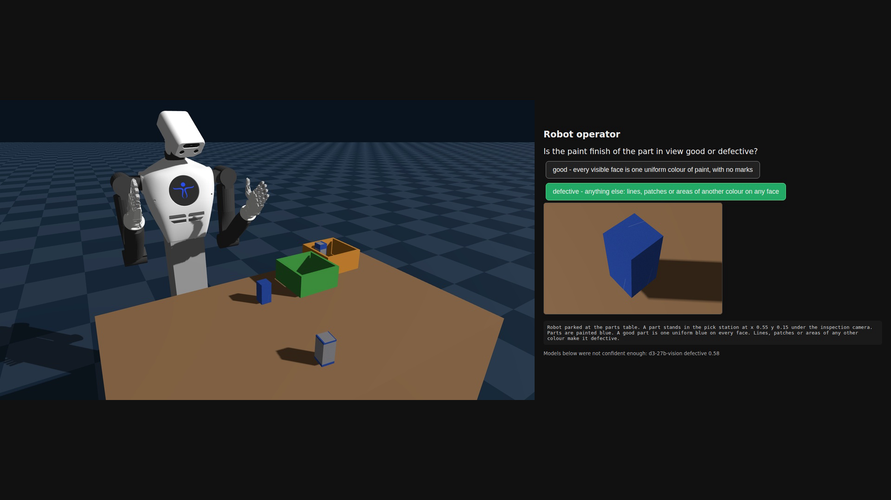

# A Humanoid That Knows When to Ask: Vision Decision Models on the Shop Floor

<!-- Kaggle writeup draft, rewritten Oct 27 for the frozen ladder; Phase 2 added Nov 7 from test05. Due Nov 13, 2026, 11:59 PM ET; NOT submitted. Every number here is in VALIDATION.md (cite the section when you change one); do not add one that is not. Square brackets mark media still to make. Sections follow the four rubric criteria in state/kaggle-overview.md. -->

**A robot on a factory floor should not act on a guess.** My entry is a Mirsee MH3 humanoid in the Genesis simulator, sorting painted parts into a good tray and a rework tray. A behaviour tree runs everything that must never fail: motion, safety stops, sensor checks. The judgement calls (is this finish defective? did the part land in the right tray?) go to a vision decision model (VDM): it reads the camera frame and returns a probability for each option instead of generating text. It answers only when it is measurably sure, and hands the question to a person when it is not. Everything runs on one local GPU, with no network.

**The result, pre-registered and scored once:** replaying the model on the 2,262 judgement decisions logged in 300 fresh episodes, the robot acted wrong on its own **2.6%** of the time (95% interval 1.7 to 3.5), decided alone and right **78.9%**, and handed **18.5%** to a person. Those were predicted before the test set was opened, and the acted-wrong prediction (1.8%) sits inside the interval.

**Phase 2 moves the same design to a job I have done by hand:** picking leaking soft-gel capsules off a tray. There the VDM (d3 27B) and a VLM are built on the same base model, Qwen3.8-27B. Scored once on 150 fresh shifts, the frozen ladder acted wrong on **0.2%** of 3,785 decisions. On its own, the VLM was 0.9+ sure that **98 to 171** leaking capsules were good; each VDM was, once.



---

## The problem: a model that doesn't know when it's wrong

I have worked final inspection at a seat plant, and inspection and deburring at a parts plant. The expensive mistake there is not a slow inspection. It is **a defective part that ships**: a bad seat that reaches the customer means an angry email to management, and the whole line hears about it.

Vision models can now look at a part and give an opinion. The trouble is trust. A model that is right 90% of the time is still wrong one time in ten. A line cannot stop every time a model hesitates, and it cannot ship parts on a guess. The robot needs a model that can say when it isn't sure, and that only helps if "not sure" means something.

So this project asks two linked questions: **can a model's confidence be trusted**, and **who should answer each question: a rule, a model or a person?**

### Vision decision models versus vision-language models

The hackathon brief suggests vision-language models (VLMs) such as Gemini Robotics or Gemma. I compared those with vision decision models (VDMs, my shorthand for decision models that read an image). Both read the camera frame. The difference is what comes back:

- **A VLM generates text.** To get a confidence, you ask it to state one, or you read the probability of the first word of its answer.
- **A VDM generates no text.** It gets the question and a fixed list of options and returns a probability for each one, tuned by its maker so those probabilities come out calibrated.

I also ran text-only decision models. They answer the same way as a VDM but can't see: they read the robot's state text plus Gemma's one-sentence description of the frame.

I replayed the same logged decisions and frames through each one (test03, 676 test decisions):

| Model | Kind | Right | Confidently wrong (0.9 or more) | Calibration error |
|---|---|---|---|---|
| d3 27B (the one I chose) | VDM | 89.8% | 0.6% | 0.037 |
| Intern-Decision-4B | VDM | 84.9% | 0.3% | 0.050 |
| Decider 2B | VDM | 78.0% | 0.0% | 0.078 |
| nimble-v3 9B | Text decision | 58.4% | 37.7% | 0.386 |
| Decider E4B | Text decision | 56.2% | 3.4% | 0.253 |
| tev1 4B | Text decision | 55.5% | 38.3% | 0.394 |
| Decider 2B, text version | Text decision | 54.7% | 0.3% | 0.262 |
| Gemma 4 e4b, first-word probability | VLM | 76.8% | 19.5% | 0.191 |
| Gemma 4 e4b, stated confidence | VLM | 72.0% | 28.0% | 0.264 |
| Gemini 4 Argon, stated confidence (cloud, a 132-decision sample) | VLM | 65.9% | 24.2% | 0.287 |

Calibration error is how far a model's stated confidence is from how often it is right; 0 is perfect. (VALIDATION: "All ten local arms on test03", "d3-nano and Intern-Decision-4B", "27B frame arms", "Gemini 4 Argon".)

- **The gap is not mainly accuracy.** The Decider 2B and Gemma e4b are about equally accurate. On these decisions the Decider was never confidently wrong; Gemma was confidently wrong on about one in five.
- **Reading the frame beats reading a description of it.** The same Decider 2B went from 54.7% right on Gemma's description to 78.0% on the frame. In a ladder with a person behind it, two text Deciders decided alone and right on 17.8% and handed off 79%; the Decider 2B on the frame decided 57.1% and handed off 36%. A text model can only be as good as the description it's given, so this is a verdict on the setup, not on those models.
- **A hand-off threshold only works on confidence that means something.** With a fitted threshold and a person behind it, Gemma e4b decided alone and right on 52.1%, handed off 41%, and was still confidently wrong on 6.8%. A 27B VDM (pplx-decider) managed 64.5%, 32% and 0.7%. A ladder of two Gemmas on their own stated confidence never handed off at all, and was confidently wrong on about a third (VALIDATION, "Ladders on test03").
- **This is not true of every VDM.** d3-edge 0.6B was confidently wrong on 43.5% of decisions, worse than any VLM in the table. d1 3B was never confidently wrong because it was rarely confident, and it was right under half the time (VALIDATION, "Six new frame arms", "Five more decision models"). A model has to be measured, which is why I replayed 40 arms.

These numbers come from the test set that chose d3, so they are the comparison behind the pick, not a pre-registered result. The final test below scored d3 alone.

## 1. Architecture: deterministic logic and AI hand-offs

### What is deterministic

A behaviour tree (`src/handoff/bt.py`, `src/handoff/tasks/sort.py`) runs the whole cell. These never go to a model:

- **Motion.** Feed the station, grasp, lift, carry, release, return home. Inverse kinematics with straight-line carries; if the IK solution jumps between 1 cm points, the arm falls back to a joint path, and the run log says so.
- **Safety stops.** A simulated hand IMU stops the arm when it feels a bump (threshold 3.0 m/s² in `config/bump.yaml`, above the 0.9 to 2.15 m/s² of clean moves in an exploratory CPU check).
- **Hard rules.** "Is it safe to grasp?" is answered by a rule when the station is crowded or a part is on the floor; the model is never asked.
- **Physical checks.** With `--scales`, a load cell under each tray answers "did the part land in the right tray?" from weight alone, before any model looks. (Not part of the scored ladder; see section 3.)
- **The grip.** The touch grip closes until the fingertip sensors feel the part, then stops. Across 30 carries it sank 4 mm into the part at most, against 16.5 mm for a fixed closure, and carried 27 of 30 cleanly against 20 (VALIDATION, "the touch grip against the fixed closure").
- **Finding the trays.** The robot locates both trays with its own camera each episode: 40 of 40 found, 1.0 mm worst error, with the trays moved up to 25 mm between runs.

### What goes to AI

Four questions leave the tree, each with a fixed list of options and a camera frame:

| Question | Options | Safe answer if nobody is sure |
|---|---|---|
| Is this part's finish good or defective? | good, defective | defective (send to rework) |
| Is it safe to grasp? | grasp, look again, ask operator, abort | ask operator |
| Did the part land in its tray? | yes, no | no |
| Is the sort complete? | yes, no | no |

### The hand-off, step by step

1. The tree reaches a question and checks the hard rules. If a rule applies, it answers and the model is never asked.
2. For "did it land in its tray?", with `--scales` on, the load cells answer if the reading is clear (one part's weight on the intended tray, nothing on the other).
3. Otherwise the VDM (d3 27B) sees the frame and the options and returns a probability for each option.
4. **If its top option is at 0.80 or more, the robot acts on it.** That threshold was fitted on an earlier test set and frozen before any model saw the final one.
5. If not, the question goes to the **operator page**: the same frame, the same options, and the model's answer and confidence. The robot holds still and waits.
6. If nobody answers within 120 s, the tree takes the **safe answer** from the table above and carries on.
7. Every decision is logged with its frame, options, each answer and confidence, who decided, and (in simulation) the truth.

### Inspect, verify, override

- **One number to read and change:** the threshold is `FROZEN_THRESHOLD` in `scripts/demo.py` (0.80); the demo refuses to run if the frozen-ladder file from the pick disagrees.
- **The operator always wins.** The page shows what the model thought and lets the person answer instead.
- **The run log is plain English**, one line per event: "in_bin part_15: scale no 1.00 => no (by scale)", "finish part_10: d3-27b-vision defective 0.60 -> human defective 1.00 => defective (by human)".
- **Every decision is replayable**, because the log keeps the frame and the state text, so a new model can be scored on old decisions without running the robot again.

An excerpt of a real run log (`output/demo/20261107-200537/run.log`, the take filmed for the video; the person's answers there are scripted):

```
20:08:44  in_bin part_15: waiting for you on the operator page http://127.0.0.1:8790/ (safe option 'no' after 120 s)
20:08:49  in_bin part_15: d3-27b-vision no 0.70 -> human no 1.00 => no (by human)
20:11:52  in_bin part_15: d3-27b-vision yes 0.99 => yes (by d3-27b-vision)
20:12:05  finish part_10: waiting for you on the operator page http://127.0.0.1:8790/ (safe option 'defective' after 120 s)
20:12:10  finish part_10: d3-27b-vision defective 0.58 -> human defective 1.00 => defective (by human)
20:12:20  safe_to_grasp part_10: waiting for you on the operator page http://127.0.0.1:8790/ (safe option 'ask_operator' after 120 s)
```

## 2. Shop-floor deployment: fully offline, one workstation

- **Everything runs on one RTX 3090** on native Windows: the Genesis simulation, the behaviour tree, the VDM (llama.cpp, about 18 GB of GPU memory) and the operator page (served on the local machine).
- **No cloud call is in the loop.** I did compare a cloud model on a 132-decision sample: as a second rung after the Decider 2B, Gemini 4 Argon tied a local 27B VDM (pplx-decider, not d3) within its interval, and on its own it was confidently wrong on about a quarter of decisions (VALIDATION, "Gemini 4 Argon"). **The cloud bought nothing measurable**, so it stayed out.
- **d3 answers in a median 277 ms** on the 3090 (benchmark replay, the model alone on the GPU; VALIDATION, "27B frame arms as 4-bit GGUFs").
- **When something drops out, the robot stays safe:**
  - If the model server stops mid-run, the call fails (at once if the connection is refused, after its 120 s timeout if it hangs), the rung is skipped, and the question goes to the person (unit-tested in `tests/handoff/test_decider.py`). The demo will not start without the model server.
  - If the person does not answer, the safe answer is taken after 120 s.
  - The video shows both: d3 stopped mid-run, the questions climbing to the operator page, then an unanswered question timing out to the safe answer ("When something fails").
- **The real robot could carry it.** The MH3 has a Jetson AGX Orin with 64 GB, and by the host's figures the robot's own stack uses 13% of its memory and half its GPU. The model fits beside it on paper; **I have not run it on an Orin**, so speed there is not measured.

## 3. Industrial impact and technical execution

### Why it matters

- **A defective part in the good tray is the costliest error this cell can make.** The cost setting says so in numbers: when the ladder was chosen, a wrong action was priced at 10 times a hand-off to a person.
- **One frame cannot show the VDM that error.** On the final test set, 15 parts landed in the wrong tray and the robot checked them 29 times; **d3 said "in the bin" all 29 times**, every one at 0.9 confidence or more. Each time the target tray already held an earlier part, so the photo really does show a part in the right tray; it just isn't this part. No confidence threshold catches this.
- **A second frame might.** In a small retest on an earlier log, shown the trays before and after, d3 said "no" on all 8 wrong-tray checks (4 landings) and still said "yes" on 147 of 148 correct landings. That is exploratory, not a scored result: I wrote the prompt after looking at those frames, and a claim needs a new test log.
- **So a physical sensor answers it.** The tray load cells read "no" on a forced wrong-bin drop, the operator moved the part, and they then read "yes" (Oct 23 demo; VALIDATION). In a 3-episode smoke run the scales answered all 9 in-bin questions, all right. That is a smoke run, not a measurement; scoring them properly needs a new test set.

This is the pattern professional cells use: **confirm a physical state with a physical sensor, and keep vision for what sensors cannot see** (the paint finish).

### What I built on the MH3 starter

- **Scene hooks:** a pick station, two trays, part feeding, forced faults (a part dropped mid-carry, a crowded station, a wrong-bin drop).
- **Step hooks:** a behaviour tree for the whole sort, with recovery: a dropped part is re-fed.
- **Perception:** tray detection from the depth camera; the frame and state text sent to the model.
- **IK manipulation:** straight-line carries holding the part level (wrist yaw left free so the MH3's wrist joints stay off their stops), the IK branch-flip fallback, a slow release that took clean sorts from 13 of 20 to 20 of 20.
- **Sensors the starter does not expose:** hand and body IMUs, joint torque, a tactile skin, fingertip force sensors and tray load cells, each with a stated noise model taken from a real part's published specs (a datasheet, a vendor listing or a published bench measurement).
- **An operator page** and a plain-English run log.
- **A benchmark harness** that replays recorded decisions against any model and scores it against the simulator's truth.
- **477 automated project tests** on a fake simulator (plus the starter's), none needing a GPU.

### How the model and threshold were chosen

1. **Record, don't hand-label.** I ran the sort with the simulator's truth answering every question and logged 974 decisions with their camera frames (test03).
2. **Replay every candidate on the same logged decisions.** 40 model arms, 38 of them local open models (Decider, d3, OneJev, StartLux, Intern, Gemma and others) and 2 cloud Gemini arms (those two on a sample).
3. **Pick on held-out episodes only.** Every cheap-to-expensive chain of the best ten arms, under three threshold fits, over ten splits. Winner: d3 27B alone, threshold 0.80.
4. **Freeze it in writing** (`docs/PREREG.md`): the cost and the scoring rules were committed before the final test set existed; the model files and hashes, server version, prompts, threshold and prediction were added before any model answered it.
5. **Make a fresh test set** (test04: 300 new episodes, 100 clean, 100 with a forced drop and 100 crowded; 3,262 decisions) and **score it once**.

On test04's 2,262 judgement questions (95% interval in brackets, then the prediction frozen before the test):

- **Acted wrong on its own:** 2.6% (1.7 to 3.5); predicted 1.8%.
- **Confidently wrong (0.9 or more):** 1.9% (1.2 to 2.5); predicted 1.4%.
- **Handed to a person:** 18.5% (16.8 to 20.2); predicted 20.7%.
- **Decided alone and right:** 78.9% (77.0 to 80.9); predicted 77.5%.

- **Judgement questions** are finish, in_bin and sort_complete. safe_to_grasp is reported apart because a hard rule answers its risky cases before the model is asked.
- **Three of the four predictions held.** The person got slightly fewer questions than predicted.
- **Selection bias was checked, not assumed.** A nested split of test03 measured no winner's-curse bias (+0.6 points, sd 1.8).
- **Counting the hard rules the way the running system does**, the robot acted wrong on 1.8% of all decisions (VALIDATION, "Live-equivalent rescoring").
- **About half of the clean episodes (52%) needed no person at all** for a judgement call.

## Phase 2: a soft-gel capsule cell, VDM against VLM on one base model

### The job

I have also worked as a sorter at a soft-gel capsule plant. Carts of trays of new capsules came in; one tray at a time, I found the "leakers" and picked them out, dumped the good capsules in a tub, and lidded it after the last tray. We picked the leakers out with our fingers, in thin nylon gloves. Phase 2 puts the MH3 at that job.

### The cell

- **No driving inside the cell.** The robot drives to the cell that needs it, parks once and brakes the base. Two half-trays of 16 capsules (4 by 4) sit inside the reach I measured palm down from that one spot, with a leaker bin on each side.
- **A leaker differs from a good capsule only by the pool under it.** There is no other give-away.
- **The pick is a palm-down pinch.** The hand on the capsule's side picks it and drops it inside that side's bin, below the rim.
- **Fixed scene cameras do the seeing:** one over the tray, one over each bin (before and after the drop), and one overview a cell. The robot's own cameras are off in these runs.

### What is deterministic, what goes to a model

The behaviour tree runs the shift: the drive, the park, the brake, every move, and the count of what landed where. Five questions leave it, each with fixed options and a picture:

| Question | Options |
|---|---|
| Which cell needs me? | left, right, neither |
| Does this half-tray hold a leaker? | yes, no |
| Is this capsule a leaker? | leaker, good |
| Did the capsule land in the bin? | yes, no |
| Is the tray clear? | yes, no |

**"Did it land?" gets a before-and-after picture.** Phase 1 taught me that one frame cannot show a wrong landing, so here the bin camera's picture shows the bin before and after the hand let go. The frozen ladder was right on all 280 landing questions.

### The comparison

**d3 27B, a VDM, is built on Qwen3.8-27B, a VLM.** Same base model, two ways of answering. I read Qwen two ways: the probability of its first answer word, and the confidence it states when asked. Intern-Decision-4B is a second VDM.

### The protocol: choose on one log, confirm on another, once

1. **Settle the scene first** (`docs/FREEZE.md`): the layout, cameras, questions, block size and arms, before any log for choosing was made.
2. **A selection log, sel03:** 150 shifts with the simulator's truth answering, every arm replayed on all 3,751 decisions. The same pick rule as Phase 1 (a wrong action costs 10 hand-offs, held-out splits by shift) chose **Intern-4B, then d3 27B, then a person**, with a threshold for each question. An earlier selection log, sel02, picked the same ladder.
3. **Freeze it** (`docs/PREREG_CAPSULES.md`): the ladder, its thresholds, the model files and hashes, the servers and the prediction, committed before the confirmation log existed.
4. **A confirmation log, test05:** 150 new shifts on seeds no earlier log used, replayed and **scored once**.

### The result (test05, 3,785 decisions, 95% by-shift intervals)

The frozen ladder, against the sel03 prediction:

- **Acted wrong on its own:** 0.2% (0.0 to 0.3), 6 decisions; predicted 0.5%.
- **Handed to a person:** 2.8% (2.3 to 3.2); predicted 2.9%.
- **Decided alone and right:** 97.1% (96.7 to 97.6); predicted 96.5%.
- **Of 467 leaker pictures,** a model caught 389, a person got 76, and 2 were passed as good. Both of those were Intern above its threshold.

Every arm alone, on the leaker questions (467 leaker pictures, 2,745 clean):

| Arm | Kind | Leakers caught | Leakers called good at 0.9 or more | Clean called leakers |
|---|---|---|---|---|
| d3 27B | VDM | 85% | **1** | 36% |
| Intern-Decision-4B | VDM | 85% | **1** | 0.1% |
| Qwen3.8-27B, stated confidence | VLM | 63% | **171** | 0.0% |
| Qwen3.8-27B, first word | VLM | 42% | **98** | 0.0% |

- **The middle column is the one that ships a leaker.** A model that is sure and wrong passes any threshold. On the same base model, the VDM was sure and wrong about a leaker once and the VLM 98 or 171 times, depending on how it was read. sel02 and sel03 showed the same pattern.
- **d3 alone over-calls leakers** (36% of clean pictures), but never at 0.9 or more, so its thresholds send those calls on. Why it over-calls is not traced.
- **The ladder uses both VDMs for what each does well.** Intern answers first, d3 takes what Intern is unsure of, and a person gets what is left.
- **The robot:** 145 of 150 shifts finished clean. 276 of 281 leakers landed in a bin; 3 fell outside the bins and 2 stayed on the tray, and each of those fails the shift. No good capsule was thrown out.

(VALIDATION: "test05: the capsule confirmation", "The selection log sel03".)

## 4. Trade-offs

- **Why a VDM, not a VLM:** its probabilities mean something, so one threshold can separate what the robot does from what it asks. The numbers are in the first section.
- **Why one model, not a chain (Phase 1):** a two-model chain scored within 0.001 of d3 alone, and the tie rule picks fewer models: one less server, less GPU memory, less to go wrong.
- **Why a chain in Phase 2:** the same rule picked two. Intern alone scored 0.973; Intern then d3 scored 0.984, well past the tie margin, and on test05 d3 answered 283 of the decisions Intern was unsure of, 2 of them wrong.
- **Why 0.80:** it falls out of the cost. With a wrong action priced at 10 hand-offs, 0.80 maximised value on test03. A plant that prices mistakes differently moves one number.
- **Why one workstation:** the latency is measured in milliseconds, the data never leaves the cell, and the cloud model did no better.
- **Why a behaviour tree:** every step is inspectable and testable, and the model can only choose among options the tree already knows how to execute.
- **Why a weld in the touch grip:** Genesis's soft contact lets fingers sink into a part a real metal part would stop. The weld stands in for a rigid part's friction grip. It is a simulation stand-in, not a model of the real grip.

## What this does not show

- **Simulation only:** one task, block-shaped parts, painted defects, an exact depth camera.
- **The test decisions sit on the path the simulator's truth took**, so the score is a replay estimate. The live system answers the same questions from the same frames, but its own mistakes can lead it down paths the log never saw.
- **The person is assumed right.** In the benchmark the person rung is the simulator's truth.
- **Why acted-wrong rose from 1.8% to 2.6%** on the new test set is not established.
- **The load cells are not part of the frozen, scored ladder.** Scoring them needs a new test set.
- **Phase 2 is simulation too:** a pool is the only sign of a leaker (no look-alikes), with one lighting and matte parchment. A leaker that falls outside a bin fails the shift; the robot does not yet retry it or call a person. The capsule scores, like Phase 1's, are replayed on the path the simulator's truth took.

## Links

- **Notebook:** https://www.kaggle.com/code/duplonicus/humanoid-decision-ladder-results: recomputes the test04 and test05 numbers from the decision logs and checks them against the published ones. Its dataset, https://www.kaggle.com/datasets/duplonicus/humanoid-decision-ladder-logs, also holds the raw test04 and test05 logs that `VALIDATION.md` cites.
- **Video:** https://youtu.be/HZKD2ckHXWo (5:01): the system end to end, Phase 1 and Phase 2, with a hand-off to a person, the model going down and a timeout to the safe answer.
- **Code:** https://github.com/duplonicus/gdg-hackathon-handoff: the full project, with `VALIDATION.md` (every number, the command behind it, and what it does not show).

Code and results: every result above has a row in `VALIDATION.md` with the command that produced it and what it does not show.
